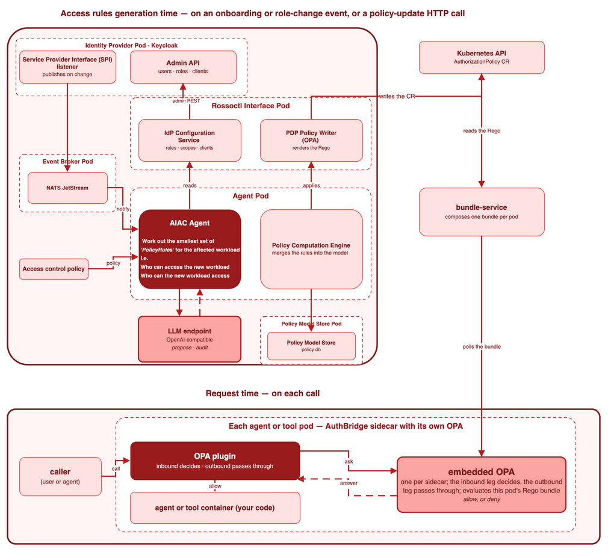

# AIAC — AI-based Access Control

AIAC is a Rossoctl platform extension that automates access control policy enforcement for AI agents
running on Kubernetes. It continuously translates natural-language access-control policy into
concrete permission rules on the active Policy Decision Point (OPA), using an identity provider
(currently Keycloak) for roles, scopes, and services.

## Architecture



The image is also the source: it embeds the diagram, so open
[docs/presentations/aiac-architecture.drawio.png](docs/presentations/aiac-architecture.drawio.png)
in [draw.io](https://app.diagrams.net/) to edit it.

AIAC enforces a strict three-layer model:

| Layer | Component | Role |
|---|---|---|
| **Policy Management** | AIAC Agent | Translates natural-language policy into PDP configuration on every trigger |
| **Policy Decision (PDP)** | OPA | Evaluates LLM-generated Rego rules; decides what a caller may access |
| **Policy Enforcement (PEP)** | AuthBridge | Intercepts traffic; exchanges tokens; carries no policy knowledge |

The AIAC Agent subscribes to an event stream (NATS JetStream) and reacts to entity lifecycle
events — new services, role changes — by consulting a Policy Rules Builder
(LangGraph, LLM-backed) and applying the minimal resulting diff through a two-layer policy stack
(policy model + Policy Computation Engine). Policy intent lives entirely in the PDP, never in
per-pod configuration.

The use cases live under `src/aiac/agent/uc/`. Service onboarding, policy update and role update
each have a spec in [docs/specs/components/aiac-agent/](docs/specs/components/aiac-agent/).

Service onboarding is implemented. A Keycloak event or `POST /apply/service/{service_id}` starts
it.

Policy update and role update are **not implemented yet**. Their handlers (`build_policy()`,
`rebuild_policy()` and `update_role()`) are stubs that return no rules. Thus these calls and
events build no rules:

- `POST /apply/policy/build` and `POST /apply/policy/rebuild`. Also, nothing publishes the
  `aiac.apply.policy.build` event yet.
- `POST /apply/role/{role_id}` and the `aiac.apply.role.*` event.

A role-membership change (`aiac.apply.role-members.*`, D32) has no use case. The consumer sends it
to the Policy Computation Engine's `rerender_role`. This gives the CRs of the role its current
holders, and does not run the Policy Rules Builder.

Offboarding is also a use case, but it has no event trigger. It is HTTP-only
(`POST /apply/offboard/{service_id}`), and a deleted workload does not start it. Offboarding is
described in the [PRD](docs/specs/PRD.md).

## Repository layout

Discover the current concrete layout live rather than relying on this snapshot:

```bash
find src/aiac -maxdepth 2 -type d
```

## Getting started

Requirements: Python >= 3.12, [uv](https://docs.astral.sh/uv/).

```bash
uv venv .venv
source .venv/bin/activate
uv pip install -e ".[test]"
```

Always use `.venv` for Python execution, tests, and dependency checks (`.venv/bin/python`,
`.venv/bin/pytest`).

## Running tests

```bash
.venv/bin/pytest                    # unit lane — offline, needs nothing
```

Selection is by marker (`-m integration`, `-m llm`, `-m system`, `-m eval`), never by path. The
lanes, what each one needs and their env are in [docs/agents/test.md](docs/agents/test.md); where to
put a new test: [docs/testing/testing-strategy.md](docs/testing/testing-strategy.md).

## Deploying to Kubernetes

The build and deploy flow is in [k8s/aiac-deployment-guide.md](k8s/aiac-deployment-guide.md). Its
"Platform preconditions" section lists the two checks of every deploy: the OPA pipeline with the
AIAC combiner, and the Keycloak event-listener SPI.

## Demo — onboarding an agent and a tool

[demo/use-cases/onboarding/](demo/use-cases/onboarding/) is a fully live, end-to-end demo. AIAC
discovers a `github-agent` and a `github-tool` deployed into `team1`. It reads a plain-English
policy (deny by default, plus two grants), and writes one `AuthorizationPolicy` CR per service.
Then the deployed AuthBridge OPA plugin allows or denies real HTTP requests with that generated
Rego. The demo proves two claims:

- **AIAC is triggered by onboarded workloads** — no one runs an onboarding command.
- **AIAC enforced a natural language policy in rossoctl** — verdicts come from the live OPA
  plugin, not from evaluating a file on the side.

The prerequisites are in [Before you start](demo/use-cases/onboarding/demo.md#before-you-start).
Then run the steps of [demo/use-cases/onboarding/demo.md](demo/use-cases/onboarding/demo.md), in
the order it gives, from that directory. Each step is a `make` target, and `make help` lists them
all. The full narrative, verification and troubleshooting are also in `demo.md`.

`make demo` is a separate, narrated walkthrough. It resets the live state, onboards by hand and
gets its verdicts from an offline `opa eval`. If the workloads are not deployed, it deploys them.
That is a first-time deploy, so it also starts the live onboarding. For the details, see
[Step 6](demo/use-cases/onboarding/demo.md#step-6--inspect-what-was-generated-optional) in
`demo.md`. `make restore` and `make teardown` clean up.

The demo workloads live under [demo/assets/](demo/assets/). See
[demo/assets/INSTALL.md](demo/assets/INSTALL.md) and their specs in
[docs/specs/demo/](docs/specs/demo/).

## Documentation

- [docs/specs/PRD.md](docs/specs/PRD.md) — master PRD
- [docs/specs/components/](docs/specs/components/) — per-component specs (design decisions live embedded here)
- [CONTEXT.md](CONTEXT.md) — domain glossary
- [demo/use-cases/onboarding/demo.md](demo/use-cases/onboarding/demo.md) — end-to-end onboarding demo
- [k8s/aiac-deployment-guide.md](k8s/aiac-deployment-guide.md) — Kubernetes install guide
- [k8s/opa-kind-runbook.md](k8s/opa-kind-runbook.md) — local OPA/Kind integration setup
- [docs/agents/](docs/agents/) — test lanes, deploy parameters, issue tracker
- [docs/testing/](docs/testing/) — testing strategy and per-pipeline test docs
- [docs/evaluation/](docs/evaluation/) — policy-pipeline evaluation framework

## Contributing

Pre-commit hooks (formatting, linting via ruff, YAML/JSON checks) are configured in
[.pre-commit-config.yaml](.pre-commit-config.yaml):

```bash
pre-commit install
```

CI runs on every PR — see [.github/workflows/](.github/workflows/).
