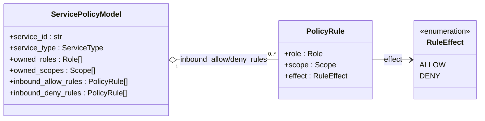
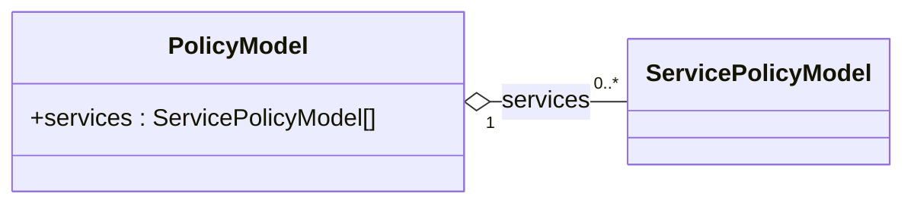

# Component PRD: Policy Model (`aiac.policy.model`)

## Problem Statement

`PolicyRule`, `ServicePolicyModel`, and `PolicyModel` were previously defined in `aiac.pdp.library.models`. Three independent consumers now need these types:

- `aiac.pdp.policy.library` — translates the policy model (`PolicyModel`) into HTTP calls to the PDP Policy Writer
- `aiac.policy.model_store.library` — reads/writes `ServicePolicyModel` (SPM) from/to the Policy Model Store
- `aiac.policy.computation` — merges rules into `ServicePolicyModel` objects and builds the policy model

Keeping the canonical model definitions inside a PDP-namespaced module (`aiac.pdp.library.models`) forces both the Policy Model Store library and the Policy Computation Engine to take a dependency on the PDP package — a wrong-layer coupling. Any of the three consumers importing from `aiac.pdp.library.models` would create a transitive dependency on an unrelated service namespace.

Additionally, the old `PolicyRule` used plain `str` for `role` and `scope`. The current SPM-based PCE and the writer require typed `Role` and `Scope` objects (from `aiac.idp.configuration.models`): the PCE routes each rule to the owning service's SPM by `scope.serviceId`, and the inbound projection classifies edges by `role.kind` and reads `role.actorIds` to build the identity maps — all fields that a plain `str` cannot carry. (These typed fields replaced the earlier reliance on `Configuration.get_services_by_role` / `get_services_by_scope`, which the SPM-based engine no longer calls.)

The original `source_roles` and `subject_roles` maps used pydantic model objects (`Service`, `Subject`) as dict keys. Model-object keys do not round-trip through `model_dump(mode="json")` / JSON without custom key handling, and they couple `aiac.policy.model` to the id-only `__hash__`/`__eq__` of the IdP models.

### Order-dependence (the reason for the SPM)

The Policy Computation Engine (PCE) merges `list[PolicyRule]` from onboarding sub-agents into policy. A model that stores a rule on the **calling agent** makes policy **order-dependent**.

Concretely, let `UR` be a user (realm) role mapped to agent `A`'s scope `AS` and tool `T`'s scope `TS`, and `AR` be agent `A`'s (client) role mapped to `TS`:

- **A onboarded, then T:** at T-onboarding `A`'s model already exists, so the `(UR, TS)` rule can attach to `A`. Correct.
- **T onboarded, then A:** at T-onboarding no agent targets `TS`, so `UR→TS` is **dropped**; A-onboarding never re-emits it, so **`UR→TS` is lost forever.**

The SPM is a **per-service model**: a persistent source of truth (`ServicePolicyModel`) that stores every inbound edge durably on the service that owns the scope — so `UR→TS` lands on `SPM(T)` at tool-onboarding, no agent required, and can never be lost. Each callee's CR is rendered from its own SPM, so no rule needs an agent to attach to.

### Allowlist-only (the former model — no negative rules)

The former model could express only **grants**. A `PolicyRule(role, scope)` was always positive — "this role *may* reach this scope" — and everything not granted was implicitly unreachable (`default allow := false`). There was no way to record that a role **must not** reach a scope. Policy authors describe access in mixed terms ("developers can read source files **but must not** touch issues"), but an allowlist-only model forced the negative to be expressed as the *absence* of a grant. That was fragile: any later, broader grant (a composite role, a role update, another onboarding) silently re-opened the path the author meant to keep closed, because no durable fact recorded the prohibition.

## Solution

A canonical, dependency-free model module at `aiac.policy.model` defines `ServicePolicyModel`, `PolicyRule`, and the policy model `PolicyModel` with typed fields. The same package has the inbound projection `project_inbound` (`aiac.policy.model.projection`) and the render-time role holders `RoleHolders` (`aiac.policy.model.holders`, D32). No HTTP client, no service code — importable by any consumer without side effects. `PolicyRule.role` and `PolicyRule.scope` are typed `Role` and `Scope` objects from `aiac.idp.configuration.models`.

**The source of truth.** `ServicePolicyModel` (SPM) is the **persistent source of truth**, one per **service** (agent *and* tool). It holds the service's **inbound** rules plus its own identity (owned roles and scopes). No other model is persisted: the policy model is built from the stored SPMs at each deploy.

**The policy model is the render input (D18, D18a, D34).** Each callee, agent or tool, checks the access to itself in its own inbound OPA, from its own CR. The PCE gives the PDP Policy Writer a **policy model**, a `PolicyModel` that holds the stored SPMs. Every edge that a callee checks is already on its own SPM, because a rule is stored on the SPM of the service that owns its scope. So the writer renders one SPM and does no join. There is no other render input.

**One inbound projection (D18b).** The function `project_inbound` splits the inbound edges of one SPM into the user gate and the calling-agent gate, and builds the identity maps. The writer uses it to render the inbound of a callee from the callee's own SPM.

**Canonical form.** *Every rule is an inbound edge on the SPM of the service that owns the rule's scope.* An agent's outbound edge is the target's inbound edge — `AR→TS` is stored on `SPM(T)`, not on `A`. The routing key is `Scope.serviceId`: a rule `(role, scope)` routes to `SPM(scope.serviceId)`.

The identity maps of the inbound projection (`source_roles`, `subject_roles`) are keyed by a plain string (a username or a clientId) rather than by a typed object, so they serialize to JSON natively and carry no hashability requirement into `aiac.policy.model`. Typed `Role` / `Scope` objects are retained as the map *values* (and in `PolicyRule`), preserving the typing the PCE needs for routing and classification.

**Two-sided rules (ALLOW / DENY).** Every rule carries a `RuleEffect` — `Allow` or `Deny` — and both kinds are stored side by side as first-class facts in **explicitly separated** parallel lists (never one intermixed list). A DENY rule is a durable prohibition that **subtracts** from what the ALLOW rules grant, honored uniformly at both inbound gates (subject and source). Generated policy applies **deny-overrides**: a request is allowed only if some ALLOW gate passes **and** no DENY gate matches, so a later broad grant can no longer silently re-open a denied path. For now the model assumes **no conflict** — no `(role, scope)` is ever both ALLOW and DENY for the same subject — so there is **no precedence/tie-break logic**; DENY simply subtracts. Cross-role conflict resolution is a deliberate later concern (see [Out of Scope](#out-of-scope)).

**Always DENY by default.** No model of this module has a default-effect field. The deployed Rego always denies a `(role, scope)` pair that **no rule mentions** (`default allow := false`, granting only what an allow gate matches). A legacy payload that still carries `default_effect` is accepted and the field is ignored (`extra='ignore'`). `RuleEffect` stays: each rule is still `Allow` or `Deny` (see [`pdp-policy-writer-opa.md`](pdp-policy-writer-opa.md)). The pass-through package is the only package that allows every request (D24, D25). It checks no rules, so no field of this module selects it: the writer renders one for the outbound of every service.

---

## User Stories

1. As the Policy Computation Engine, I want to import `PolicyRule`, `ServicePolicyModel`, and `PolicyModel` from a shared, neutral namespace, so that I do not take an unwanted dependency on the PDP package.
2. As the PDP Policy Library, I want to import the policy model `PolicyModel` from `aiac.policy.model`, so that my HTTP serialization logic does not duplicate model definitions.
3. As the Policy Model Store Library, I want to import `ServicePolicyModel`, `Role`, and `Scope` from `aiac.policy.model`, so that response deserialization uses the same canonical types as every other consumer.
4. As an AIAC Agent sub-UC agent, I want to construct a `PolicyRule` with typed `Role` and `Scope` objects, so that the PCE can use them for IdP queries without additional type conversion.
5. As the PDP Policy Writer, I want `source_roles` and `subject_roles` keyed by plain strings (a username or a clientId), so that the inbound projection builds them from `role.actorIds` and they serialize to JSON without custom key handling.
6. As a developer, I want all models to silently ignore unknown fields from API responses, so that IdP API additions do not break deserialization.
7. As a policy author, I want to tag a rule `Deny` so that it records a durable prohibition, independent of the grants around it.
8. As a consumer, I want `PolicyRule.effect` to default to `Allow`, so that existing allow-only producers keep working without change.
9. As a consumer, I want ALLOW and DENY rule sets held in separate lists, so that a gate can evaluate the grants and the prohibitions without filtering an intermixed list by effect.
10. As the PDP Policy Writer, I want a role that appears **only** in DENY edges still registered into the effect-agnostic identity maps (`subject_roles` / `source_roles`), so that the Rego deny lookup can resolve it at request time.
11. As a policy author, I want a pair that no rule mentions to be always denied, so that every render gives the same least-privilege behavior.
12. As the PDP Policy Writer, I want one `POST /policy` or `PUT /policy` body to parse into `PolicyModel`, so that a body without `services` is rejected and writes no CR.
13. As the PDP Policy Writer, I want one pure projection of an SPM's inbound edges into the two inbound gates, so that I render the inbound of a callee from its own SPM with no join.

---

## Implementation Decisions

### Module Identity

**Namespace:** `aiac.policy.model`

**Location:** `src/aiac/policy/model/`

**Package structure:**

```
src/aiac/policy/
└── model/
    ├── __init__.py    # empty
    ├── models.py      # ServicePolicyModel, PolicyRule, RuleEffect, PolicyModel
    ├── projection.py  # project_inbound, InboundProjection (D18b)
    └── holders.py     # RoleHolders: render-time role holders (D32), pure, no I/O
```

### Dependencies

| Dependency | Purpose |
|------------|---------|
| `pydantic` | `BaseModel`, `ConfigDict` |
| `aiac.idp.configuration.models` | Typed `Role`, `RoleKind`, `Scope`, `Service`, `ServiceType`: `Role`, `Scope` and `ServiceType` as map values, in `PolicyRule`, and in `ServicePolicyModel`; `RoleKind` for the split of `project_inbound` and for `RoleHolders`; `Service` as the catalog that `RoleHolders` reads |

No HTTP client dependency. No `requests`, no `python-dotenv`.

### Pydantic Models

All models use `model_config = ConfigDict(extra='ignore')`.

#### Class Diagrams

Class relationships split by root class.

**`ServicePolicyModel`** — the persistent source of truth, one per service. Every rule lands here as an inbound edge on the SPM that owns the rule's scope.



**`PolicyModel`** — the deploy input (D18a). It holds stored SPMs, one per callee.



Legend: `o--` aggregation (holds a list of); `-->` reference (a field of this type).

#### New `Role` / `Scope` fields (defined in `aiac.idp.configuration.models`)

The SPM model requires ownership and a user/agent distinction on the IdP types. These fields are **defined in `aiac.idp.configuration.models`** (the deep population from Keycloak is handoff 02's concern), but the policy model depends on them for SPM routing and the inbound projection:

- **`Scope.serviceId: str`** — the `serviceId` of the owner of **this copy** of the scope. This is the SPM routing key: a rule `(role, scope)` routes to `SPM(scope.serviceId)`. A scope that several services share ([D32](../PRD.md#key-architectural-decisions)) has one copy for each owner, each with its own `serviceId`, so each copy routes to the SPM of its owner. One policy decision gives one rule for each copy.
- **`RoleKind(str, Enum)`** — `USER = "User"`, `AGENT = "Agent"` (mirrors `ServiceType`'s style).
- **`Role.kind: RoleKind`** — whether the role is held by users or by agent service accounts.
- **`Role.actorIds: list[str]`** — context-dependent on `kind`:
  - `kind == AGENT` ⇔ a Keycloak **client role** on the agent's client, or an `aiac.managed` **realm role** on the agent's service account; `actorIds` = the owning **agent `serviceId`(s)** (usually one).
  - `kind == USER` ⇔ a Keycloak **realm role**; `actorIds` = the **holder usernames**.
  - **On a stored edge, `actorIds` is a snapshot** of the holders at build time. It is not the authority ([D32](../PRD.md#key-architectural-decisions)). At each operation the PCE replaces it with the **current holders** (`RoleHolders`, `aiac.policy.model.holders`): for an `Agent`-kind role, the live services whose roles contain the role; for a `User`-kind role, the direct members that `get_roles()` gives now. So a holder that comes later is added, and a holder that goes is removed, with no new rule. The store schema does not change. The PCE refreshes the stored snapshot each time it writes an SPM. A `compute_and_apply` run deploys each SPM that it touches, also when no rule changed, and also writes each touched SPM whose stored holders are not the current ones. The catalog decides the kind: a role that a service in the catalog holds is an agent role, also when the edge carries `kind=User` (a child of a composite role). The run that lifts a quarantine also deploys each SPM that has an edge of a role of the lifted service, and writes those of them whose stored holders are stale. Other SPMs keep their snapshot until a later write (for example an SPM that no run touches, an SPM that `rerender_role` or the resync renders, or a shared SPM that a quarantine or a decommission redeploys but does not write), and their CRs get the current holders at the next deploy, role re-render or resync. Until that write, the CR can name other holders than the snapshot. A later run that touches the SPM repairs the CR; an SPM that no run touches keeps the CR until its next render (a known limit). See [`policy-computation-engine.md` → Role holders at render time (D32)](policy-computation-engine.md#role-holders-at-render-time-d32).

A `model_validator` on `Role` enforces what it can locally (`kind` present/valid; `actorIds` is a `list[str]`). The **cross-kind** invariant (Assumption 1) and the **client/realm ⇔ agent/user** invariant (Assumption 3) are enforced **upstream at construction** (the Keycloak IdP boundary), because the raw Keycloak facts are only visible there — see handoff 02 for that enforcement and field population.

#### `RuleEffect`

```python
class RuleEffect(str, Enum):
    ALLOW = "Allow"
    DENY = "Deny"
```

A string enum (mirroring `ServiceType` / `RoleKind`) tagging a `PolicyRule` as a **grant** (`Allow`) or a **prohibition** (`Deny`). Serializes as the string `"Allow"` / `"Deny"`.

#### `ServicePolicyModel`

The persistent source of truth — one per service (agent *and* tool), keyed by `service_id`. Holds the service's inbound rules plus its own identity.

| Field | Type | Description |
|-------|------|-------------|
| `service_id` | `str` | The owning service's id. |
| `service_type` | `ServiceType` | `Agent` or `Tool`. It selects the inbound render of the service's CR (a tool inbound or an agent inbound). The PCE seeds it from the catalog (`Service.type`) when the catalog has a type for the service. See [`policy-computation-engine.md` → P2 / P5b reconciliation](policy-computation-engine.md#p2--p5b-reconciliation). |
| `owned_roles` | `list[Role]` | This service's own roles (`Service.roles`; `aiac.managed` marker only). |
| `owned_scopes` | `list[Scope]` | This service's exposed scopes (`aiac.managed` marker only). |
| `inbound_allow_rules` | `list[PolicyRule]` | Canonical positive edges: every `Allow` rule granting access to `owned_scopes`. |
| `inbound_deny_rules` | `list[PolicyRule]` | Canonical negative edges: every `Deny` rule prohibiting access to `owned_scopes`. |

`inbound_rules` splits into two **explicitly separated** parallel lists — `inbound_allow_rules` + `inbound_deny_rules` — not one intermixed list filtered by `effect`. `owned_roles` / `owned_scopes` are the service's own identity, filtered to the `aiac.managed` marker (this is where the PCE's P2 identity now lives). They are seeded from the catalog by the PCE; this module only defines the shape. `ServicePolicyModel` round-trips through `model_dump(mode="json")` / `model_validate()` with string keys only.

The stored SPM is also the **render input** (D18): `PolicyModel.services` carries stored SPMs as they are. An SPM with zero rules is valid there. A successful onboarding stores the SPM of its focus service also when it has zero rules (D21), so the service joins the **managed set** (the services that have a stored SPM) and gets a CR.

#### `PolicyRule`

A single access rule pairing a typed role with a typed scope, tagged with an effect. Used in the inbound rule lists of an SPM and of the inbound projection.

| Field | Type | Description |
|-------|------|-------------|
| `role` | `Role` | Typed role from `aiac.idp.configuration.models` |
| `scope` | `Scope` | Typed scope from `aiac.idp.configuration.models` |
| `effect` | `RuleEffect` | `Allow` (default) or `Deny`. Defaulting to `Allow` keeps existing allow-only producers working unchanged. |

**Dedup identity is `(role.id, scope.id, effect)`** (was `(role.id, scope.id)`). Including `effect` lets the same `(role, scope)` exist once as `Allow` and once as `Deny` without one clobbering the other on append. (Under the no-conflict assumption that never happens for the *same subject*, but the identity is effect-aware regardless.)

#### The policy model — `PolicyModel` (D18a)

A partial or full system policy model. When sent to `POST /policy` on the PDP Policy Writer (via `aiac.pdp.policy.library.apply_policy`), it may contain only the services whose CRs must change. When sent to `PUT /policy` (via `replace_policy`, the resync), it contains every managed service.

```python
class PolicyModel(BaseModel):
    model_config = ConfigDict(extra="ignore")

    services: list[ServicePolicyModel]        # stored SPMs, one per callee
```

| Field | Type | Description |
|-------|------|-------------|
| `services` | `list[ServicePolicyModel]` | The stored SPMs of the callees to deploy, one CR each. An SPM with zero rules is valid. |

Rules:

- **The body.** `POST /policy` and `PUT /policy` take `PolicyModel`. Code builds it as `PolicyModel(services=[...])`.
- **`services` is mandatory.** A body without `services` fails validation, and the writer returns **422**. Nothing is written.
- **An unknown field is ignored** (`extra='ignore'`).
- **An entry is one CR.** Each `services[]` SPM is one CR.

#### The inbound projection — `aiac.policy.model.projection` (D18b)

```python
def project_inbound(spm: ServicePolicyModel) -> InboundProjection
```

A pure function with zero I/O. It projects the inbound edges of one SPM into the two inbound gates, and builds the identity maps.

| `InboundProjection` field | Type | Content |
|---------------------------|------|---------|
| `subject_allow_rules` | `list[PolicyRule]` | The `User`-kind edges in `spm.inbound_allow_rules` (the user gate, allow). |
| `subject_deny_rules` | `list[PolicyRule]` | The `User`-kind edges in `spm.inbound_deny_rules` (the user gate, deny). |
| `source_allow_rules` | `list[PolicyRule]` | The `Agent`-kind edges in `spm.inbound_allow_rules` (the calling-agent gate, allow). |
| `source_deny_rules` | `list[PolicyRule]` | The `Agent`-kind edges in `spm.inbound_deny_rules` (the calling-agent gate, deny). |
| `subject_roles` | `dict[str, list[Role]]` | Username → the roles that the user holds, from `role.actorIds` of every `User`-kind edge. **Effect-agnostic.** |
| `source_roles` | `dict[str, list[Role]]` | Calling clientId → the roles that the agent holds, from `role.actorIds` of every `Agent`-kind edge. **Effect-agnostic.** |

The PCE gives `project_inbound` SPMs whose edges carry the current role holders (D32), so `subject_roles` and `source_roles` show who holds each role now, not who held it when the rule was built. The split is by `role.kind` (`User` → subject, `Agent` → source) and by effect (the SPM's allow list or deny list). The identity maps register the role of **every** edge, allow and deny. So a role that appears only in a DENY edge is still in the map, and the Rego deny lookup can resolve it. Rules dedup by `(role.id, scope.id, effect)`. Map entries dedup by `role.id`.

The PDP Policy Writer uses it. The renderer of a callee's inbound package projects the callee's own SPM. The user gate keys on `subject_roles[input.identity.subject]`. The calling-agent gate keys on `source_roles[input.identity.client_id]`. The writer projects one SPM and does no join. The PCE uses only the append-dedup helper `add_rule` of this module (for the routing).

### Map keys are string IDs

`source_roles` and `subject_roles` (the identity maps of `InboundProjection`) are keyed by a plain string — the source service's clientId and the subject's username — rather than by the typed `Service` / `Subject` object. Rationale:

- JSON object keys must be strings. A dict keyed by a pydantic model does not round-trip through `model_dump(mode="json")` / JSON without a custom key serializer; a `str` key serializes natively.
- The IdP models are plain pydantic models (default field-based equality, not hashable). `project_inbound` builds these maps from `role.actorIds`.

As a result, no field in `aiac.policy.model` uses a typed object as a dict key. From `aiac.idp.configuration.models`, `models.py` imports only `Role`, `Scope`, and `ServiceType` (as map *values*, in `PolicyRule`, and in `ServicePolicyModel`); `projection.py` also imports `RoleKind`; `holders.py` imports `Role`, `RoleKind`, and `Service` (the catalog that `RoleHolders` reads, never a dict key). `Subject` is not referenced.

### Usage

```python
from aiac.policy.model.models import (
    PolicyModel, PolicyRule, RuleEffect, ServicePolicyModel,
)
from aiac.policy.model.projection import project_inbound
from aiac.idp.configuration.models import Role, RoleKind, Scope, ServiceType

reader = Role(id="r1", name="weather-reader", composite=False, kind=RoleKind.USER, actorIds=["u1"])
issues_role = Role(id="r2", name="developer", composite=False, kind=RoleKind.USER, actorIds=["u2"])
read = Scope(id="s1", name="read", serviceId="team1/github-tool")
issues = Scope(id="s2", name="issues", serviceId="team1/github-tool")

allow_rule = PolicyRule(role=reader, scope=read)                       # effect defaults to Allow
deny_rule = PolicyRule(role=issues_role, scope=issues, effect=RuleEffect.DENY)

tool_spm = ServicePolicyModel(
    service_id="team1/github-tool",
    service_type=ServiceType.TOOL,
    owned_roles=[],
    owned_scopes=[read, issues],
    inbound_allow_rules=[allow_rule],
    inbound_deny_rules=[deny_rule],
)

# The policy model: the stored SPMs as they are
model = PolicyModel(services=[tool_spm])
assert model.model_dump(mode="json").keys() == {"services"}

# The inbound projection of one SPM (the writer uses it)
gates = project_inbound(tool_spm)
assert set(gates.subject_roles) == {"u1", "u2"}         # deny-only user u2 is still listed
```

### Replaces

`aiac.pdp.library.models` has been removed. All consumers import from `aiac.policy.model.models`.

---

## Assumptions

The SPM model rests on two invariants, 1 and 3 below (the former Assumption 2 is removed, [D32](../PRD.md#key-architectural-decisions)). Both are **AIAC invariants**, not Keycloak guarantees, and they are enforced upstream at the IdP boundary (handoff 02), because they need raw Keycloak facts:

1. **No role spans both kinds.** A role is held by users *or* by agent service accounts, never both. This is what lets `Role.actorIds` be a single list. Enforced upstream at construction (cross-kind invariant not visible to the local `Role` validator).
2. **Removed by D32** (it was: no scope shared across services). A shared scope is valid: a realm is a tenant, and one policy covers all its AIAC-managed services. Each owner gets its own copy of the scope, with `Scope.serviceId` = that owner, so `SPM(scope.serviceId)` stays unambiguous for each copy. `get_services_by_scope(scope) -> list[Service]` can give more than one service.
3. **Agent role ⇔ a client role on the agent's client, or an `aiac.managed` realm role on its service account; user role ⇔ a realm role held by users.** The IdP config service sources agent roles from `Service.roles` and sets `Role.kind`: `GET /services/{id}/roles` marks agent roles `Agent`, and `GET /roles` marks realm roles `User`. Enforced upstream at construction.

---

## Testing Decisions

**Seam:** model instantiation and serialization — no HTTP boundary, no mocking required.

Key behaviors to assert:
- `Scope.serviceId` is present; `Role.kind` (a `RoleKind`) and `Role.actorIds` (a `list[str]`) are present; the `Role` `model_validator` accepts a valid `kind` + `list[str]` `actorIds` and rejects a malformed one.
- `RuleEffect` values serialize as `"Allow"` / `"Deny"`; `PolicyRule.effect` defaults to `RuleEffect.ALLOW` when omitted.
- The same `(role, scope)` coexists as one `Allow` and one `Deny` rule (dedup identity `(role.id, scope.id, effect)` keeps them distinct).
- `ServicePolicyModel` constructs with `service_id`, `service_type`, `owned_roles`, `owned_scopes`, `inbound_allow_rules`, `inbound_deny_rules`, and round-trips via `model_dump(mode="json")` / `model_validate()` (string keys only) with typed `Role` / `Scope` / `PolicyRule` values preserved.
- `PolicyRule` accepts typed `Role` and `Scope` objects; rejects plain `str` where `Role`/`Scope` is expected.
- The two SPM rule lists default to empty (constructors that omit them still validate).
- `ConfigDict(extra='ignore')` causes unknown fields to be silently discarded on `model_validate()` (this is exactly why the rename requires a store reset — see Migration).
- **The policy model (D18a).** A body with `services` parses to `PolicyModel` and its SPMs. A body without `services` fails validation. An unknown field is ignored. `PolicyModel(services=[...])` round-trips through `model_dump(mode="json")`, and the dump has only the key `services`.
- **The inbound projection (D18b).** `project_inbound` splits the edges of one SPM by `role.kind` and effect into the four rule lists. A role that appears only in a DENY edge is in `subject_roles` / `source_roles` (the identity maps are effect-agnostic). Duplicate edges collapse. An SPM with zero rules gives empty lists and empty maps. See `test/unit/policy/model/test_projection.py`.
- **The role holders (D32).** `RoleHolders` gives an `Agent`-kind role every live service in the catalog that has the role. A disabled service is not a holder, but the focus service is a holder also while it is disabled; `live` gives the enabled services and the focus service. It gives a `User`-kind role the current members that `get_roles()` lists, and no holder when `get_roles()` does not list the role. A role that a service in the catalog holds (enabled or not) is an agent role whatever kind the edge carries (`is_agent_role`), and `refresh_role` sets `kind=Agent` on it; a role that no service holds keeps the kind of its edge. Each source is used only for its kind, and the catalog order does not change the holders. `refresh_role`, `refresh_rule` and `refresh_model` return copies: the scope and the effect of a rule do not change, and `refresh_model` refreshes every edge in both lists and keeps their order. See `test/unit/policy/model/test_holders.py`.

---

## Out of Scope

- HTTP serialization logic — handled by `aiac.policy.model_store.library`, `aiac.policy.model_store.service`, and `aiac.pdp.policy.library`.
- IdP API integration — `Service`, `Role`, `Scope` shapes are owned by `aiac.idp.configuration.models`.
- Rule revocation semantics — TBD; no model changes required until the design is finalised.
- **PRB deny-extraction** — pulling `Deny` rules out of natural-language policy text is the Policy Rules Builder's concern, not this model module's; this module only defines the `effect` field the PRB populates. (The PRB now extracts `Deny` rules — explicit prohibitions, description-driven denies, and the derived exclusivity complement — see [`aiac-agent/policy-rules-builder.md`](aiac-agent/policy-rules-builder.md).)
- **Conflict / precedence resolution** — the model assumes no `(role, scope)` is both `Allow` and `Deny` for the same subject, so there is no tie-break. Cross-role ALLOW-vs-DENY conflict resolution is an explicit later concern.

---

## Migration (state reset, no back-compat)

**Symmetric rename, no alias, no dual-read shim, no record migration.** `inbound_rules` → `inbound_allow_rules` + `inbound_deny_rules` (SPM) is a hard rename. Because every model uses `ConfigDict(extra='ignore')`, loading an old single-list record would **silently drop** the now-unknown `inbound_rules` field and yield a stale, half-migrated read. So the Policy Model Store state is **nuked out-of-band and re-seeded by re-onboarding** — there is no alias, no dual-read compatibility path, and no migration of old records. All generated `.rego` golden fixtures are regenerated as part of the rollout.

## Further Notes

- Keying maps by string `id` sidesteps the previous reliance on id-only hashing of the IdP models: two records for the same Keycloak entity fetched at different times (with potentially different enrichment fields) collapse to the same string key regardless of those differences.
- The `effect` split lives **only** in the rule lists (`inbound_allow_rules` / `inbound_deny_rules` of the SPM, and the four `*_allow_rules` / `*_deny_rules` lists of `InboundProjection`). The identity maps (`subject_roles`, `source_roles`) remain effect-agnostic and must include deny-edge roles so the Rego deny lookup can resolve them.
